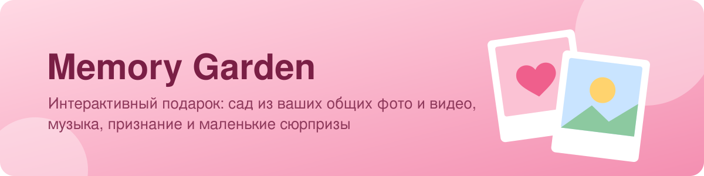

<div align="center">



<br>

**Интерактивный подарок для любимого человека: прогулка по саду из ваших общих воспоминаний.**

[](https://rampaaage.github.io/memory-garden/)
[](https://github.com/RAMPAAAGE/memory-garden/releases/latest/download/Memory-Garden.exe)


</div>

---

## Что это

Я сделал этот проект как подарок на годовщину. Здесь выложен **шаблон**: вместо личных фото стоят заглушки, и любой может вставить свои фото, видео, тексты и музыку и подарить такой же своему человеку.

## Как это выглядит

1. **Приглашение.** «Хочешь отправиться в приключение?» Кнопка «Нет» убегает от курсора, а «Да» превращается в пиксельное сердце.
2. **Сад воспоминаний.** Колесом мыши или стрелками идёшь по 3D-саду, а вдоль дорожки появляются ваши фото и видео с подписями и датами.
3. **Признание.** Тёплые слова и вопрос «Любишь ли ты меня?». На кнопку «Нет» каждый раз находится новый ответ 😉, а на «Да» летит конфетти
4. **Финал.** Любимая песня и кнопка «Повторить путешествие».

Есть фоновая музыка, полноэкранный режим (F11), таймер до даты открытия и пароль для веб-версии.

## Сделать свой подарок

```bash
git clone https://github.com/RAMPAAAGE/memory-garden.git
cd memory-garden
npm install
```

| Что поменять | Где |
|---|---|
| 📷 **Фото и видео** | Положи их в папку `../фотки/` (рядом с проектом) и запусти `npm run media`. Программа сама сожмёт файлы, а iPhone-фото `.HEIC` и видео `.MOV` переведёт в нужный формат. Для видео нужен установленный [ffmpeg](https://ffmpeg.org/download.html) |
| ✍️ **Подписи к фото** | `воспоминания.txt`: одна строка = одно воспоминание, в формате `файл \| текст` или `файл \| заголовок \| текст` |
| 💬 **Тексты сцен** | `src/config.ts`: вопрос, признание, надписи на кнопках |
| 🎵 **Музыка** | Положи `meow.mp3` (играет всё время) и `velosiped.mp3` (финал) в `public/music/`. Без них подарок работает без звука |
| 🔒 **Пароль для сайта** | `npm run password -- твой_пароль` |
| ⏳ **Таймер до даты** | `unlockAt` в `src/config.ts`, например `'2026-12-31T00:00:00'` |
| 🐶 **Стикеры** | PNG с прозрачным фоном в `src/stickers/`, они появятся на первом экране |

Посмотреть результат: `npm run app`. Собрать `.exe`: `npm run dist`, готовый файл появится в `release/Memory-Garden.exe`.

## Как это устроено

- **TypeScript + Vite**: каждый экран (`src/scenes/`) сам себя рисует и сам за собой убирает.
- **Three.js**: 3D-сад с цветами и мягкой камерой, которая движется вместе со скроллом.
- **sharp и heic-convert**: подготовка фото, чтобы подарок весил немного и быстро грузился.
- **Electron**: оборачивает сайт в одну программу `.exe`, которую можно запустить с флешки без установки.
- **GitHub Actions**: сам собирает `.exe` для каждого релиза и обновляет веб-версию на GitHub Pages.

---

<div align="center">

Сделано с ♥ · [RAMPAAAGE](https://github.com/RAMPAAAGE)

</div>
